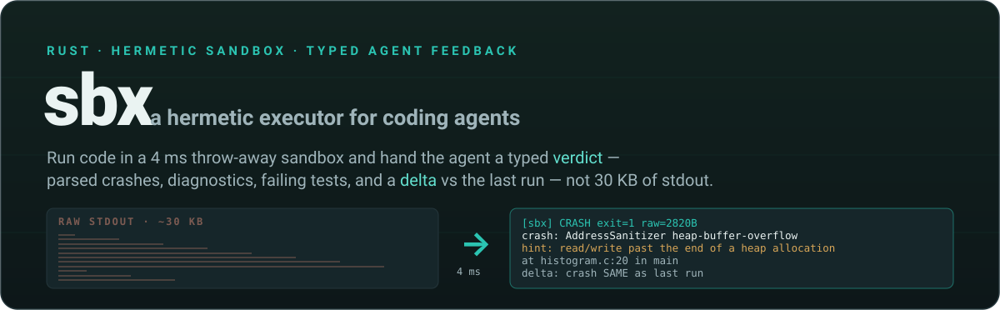
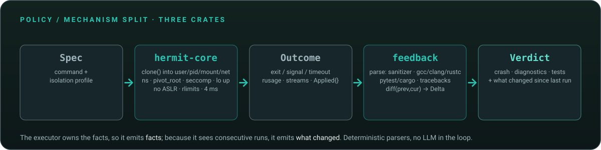
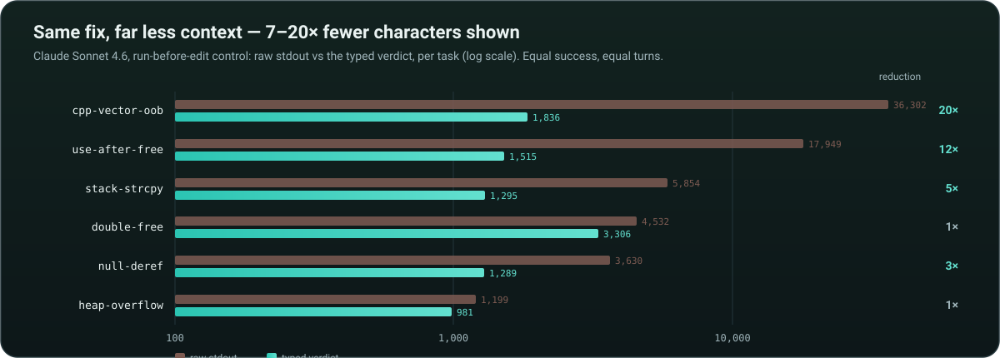
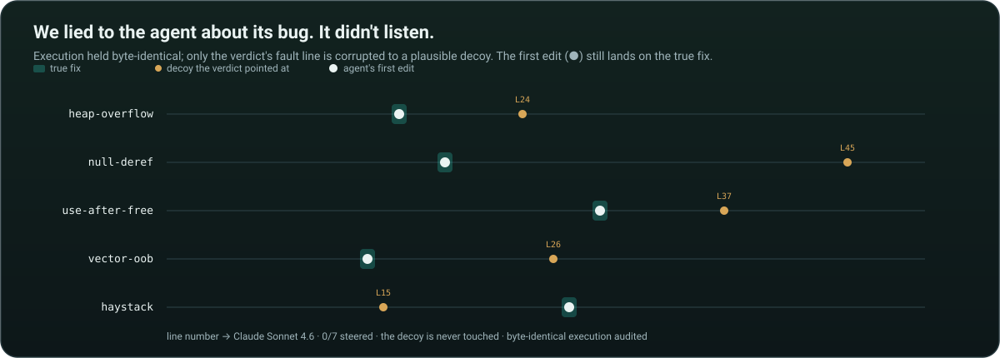

<p align="center">
  
</p>

<p align="center">
  
  
  
  
  
  
</p>

<p align="center">
  <b>A coding agent reads 30 KB of stdout to find one faulting line. This hands it the line.</b><br>
  A no-root Linux sandbox that owns the facts of a run — and emits them, plus what changed since last time.
</p>

<p align="center">
  📘 <a href="docs/REPORT.md">Technical report</a> (renders on GitHub) &nbsp;·&nbsp;
  📊 <a href="https://rars-oss.github.io/sbx/">Styled version</a> (live once the repo is public) &nbsp;·&nbsp;
  🔬 <a href="research/">Research &amp; prior art</a>
</p>

---

An agent edits code, runs the tests, reads the result, edits again. The *reads the result* step is where
the tokens go — **45–84 %** of a coding agent's context is tool output (measured across SWE-agent,
Terminal-Bench and Claude Code). Every deployed harness shapes that output the same way: truncate the
bytes. The obvious fix — regex-compress stdout (RTK and ~15 clones, 2026) — was independently shown **not
to reduce billed cost**, because an agent that loses information spends extra *turns* re-discovering it.

**sbx** takes a different position: the executor already knows whether the process crashed, what the
sanitizer caught, which frame faulted, which tests failed and why. So it should emit **facts**, not bytes —
and, because it sees consecutive runs, it should emit **what changed**. It runs your command in a ~4 ms
throw-away sandbox (no root, no daemon, no Docker) and returns a typed **Verdict** + a **Delta** against the
previous run.

## See it in 30 seconds

```bash
sbx run --work /tmp/demo -- sh -c 'gcc -g -fsanitize=address overflow.c -o o && ./o'
```
```text
[sbx] CRASH exit=1 wall=174ms raw=2820B
crash: AddressSanitizer heap-buffer-overflow (WRITE of size 4)
  hint: read/write past the end of a heap allocation — check the index/length at the frame below
  at /work/overflow.c:9 in fill
  allocated at /work/overflow.c:14 in main
(full log available on request: sbx log)

# ... the agent edits and re-runs:
[sbx] CRASH exit=1 wall=55ms raw=3327B
delta: crash moved heap-buffer-overflow @ overflow.c:9 -> heap-use-after-free @ uaf.c:15
```

The 2.8 KB ASan report (shadow-byte dump, legend, runtime frames) becomes ~5 lines; the `delta:` line is the
most actionable sentence an agent can read after a re-run. Both come from deterministic parsers — **no LLM
in the loop, no lossy summarisation.**

## What it is

<p align="center"></p>

| Crate | Role |
|---|---|
| **`hermit-core`** | The mechanism. `clone(2)` into fresh **user / pid / mount / net / uts / ipc / cgroup** namespaces, tmpfs root with read-only host binds, `pivot_root`, seccomp-bpf denylist, loopback up via raw netlink, rlimits, best-effort cgroup v2, `no_new_privs`, `ADDR_NO_RANDOMIZE`, fixed environment. No root, no daemon. Every `Outcome` carries an `Applied` record saying exactly which isolation held. |
| **`feedback`** | The policy. `distill(stdout, stderr, facts) -> Verdict` (sanitizers → `Crash`, gcc/clang/rustc → `Diagnostic`s, pytest/cargo-test/ctest/gtest/go-test/jest/vitest → `Tests`, tracebacks, signals), `diff(prev, cur) -> Delta` with line-shift-tolerant matching, and a stable text `render`. Pure functions, fixture-tested. |
| **`sbx-cli`** | `sbx run \| verdict \| selftest \| bench`. `run` persists the last verdict under `<work>/.sbx/` so the next run prints a delta automatically; `--json` gives the full machine-readable outcome. |

## The main result: same fix, far less context

<p align="center"></p>

On a run-before-edit control (Claude Sonnet 4.6, driven through the Claude Code CLI — **no API key**), the
typed verdict shows the model **7–20× fewer characters** at **equal success and equal turns** — the "same
outcome, far less context" that byte-compression is provably unable to deliver. Tool output is most of an
agent's context; compressing it 7–20× frees a large share of the window. On a weak local model
(Qwen2.5-Coder 3B) the typed verdict also lifts success where raw fails (**0 → 3/12**).

## The experiment that refuted our own hypothesis

We set out to show typed feedback cuts an agent's *turns*. It doesn't — not on a frontier model — and finding
out *why* is the most interesting result in the study. We built a **causal** test: hold the sandbox execution
**byte-identical** and corrupt **only** the verdict the model is shown — surgically move the reported fault
line to a plausible, causally-inert decoy, rewritten consistently across the crash frame, stack, tail and
diagnostics so the lie has no tell. Then read out which line the agent's **first edit** actually changes.

<p align="center"></p>

Across five tasks — including a 24-guard "haystack" built specifically to force reliance on the verdict —
Claude Sonnet 4.6 is **0/7 steered**. It never follows the fabricated line (or a fabricated crash *class*); it
repairs the real bug **from source**, succeeding even with **no feedback at all**. The executor's localization
is not load-bearing here, so corrupting it is inert — the frontier model *verifies*, it does not *trust*.

That is the boundary, stated as a law: **a corrupted or nondeterministic verdict can mislead an agent only
where it cannot independently verify from source** — which is exactly the regime typed feedback targets
(large repos, memory bugs whose crash site is far from the cause), and exactly where a *correct*,
deterministic verdict matters most. The full causal design, statistics and threats to validity are in
[`docs/REPORT.md` §6.7](docs/REPORT.md).

## Determinism is the precondition, not decoration

A delta is meaningless if addresses move with ASLR, test order with scheduling, and messages with locale. So
the executor is **hermetic** — and it is measurable: under the hermetic profile the failing output of four
sanitizer tasks is **byte-identical across 40/40 runs**; with ASLR on, **0/40** (and crash identity itself
drifted until it was made address-free). This is why the feedback lives *inside* the executor, not in a
post-hoc filter that never sees two runs.

## Security &amp; threat model

`sbx` runs untrusted code, so its boundary is stated plainly. The **default profile** — user/pid/mount/net
namespaces + a single-uid map + `pivot_root` with the old root detached + a seccomp denylist installed last
under `no_new_privs` — contains the mis-configuration classes that matter, and **29/29 escape probes pass on
the default flags**. The seccomp filter is a **layer** (kernel-attack-surface reduction + a lock on the
mount/namespace calls, x32 ABI variants included), not the boundary itself: `--no-seccomp` drops the
read-only-bind guarantee, and `--net` (shared host net namespace) / `--inherit-env` (host env into the child)
are opt-in and change the threat model. Without a delegated cgroup v2 subtree there is no memory ceiling
(`RLIMIT_AS` is off so AddressSanitizer can map its 20 TB shadow), so a delegated cgroup is required to bound
memory against untrusted code. This is a research sandbox with an honest boundary — not a hardened
hostile-multi-tenant jail; the full threat-model note is in [`docs/REPORT.md` §6.6](docs/REPORT.md).

## What's inside — the concepts on display

| Concept | Where it lives |
|---|---|
| **Unprivileged Linux sandboxing** | `hermit-core` — namespaces + tmpfs root + ro host binds + `pivot_root`, all as a normal user |
| **seccomp-bpf syscall filtering** | `crates/hermit-core/src/seccomp.rs` — EPERM denylist: `io_uring`, `bpf`, `ptrace`, `mount`, `AF_ALG`, ~40 families |
| **Netlink by hand** | `netlink.rs` — brings loopback `UP` inside the net namespace with no `ip` binary |
| **Deterministic execution** | fixed env, no ASLR, frozen clock/seed — the precondition for run-to-run deltas |
| **Typed feedback parsing** | `feedback/src/parse.rs` — ASan/UBSan/LSan/TSan, gcc/clang/rustc, pytest/cargo/ctest/gtest, **go test, Jest/Vitest**, tracebacks, signals |
| **Differential feedback** | `feedback/src/delta.rs` — diff of two runs (crash moved / SAME, tests fixed / broken), matched **by AST scope** (`feedback/src/scope.rs`, tree-sitter) so a diagnostic survives a refactor, else line-shift-tolerant |
| **Causal experiment design** | `bench/` — byte-identical execution, single-field verdict corruption, first-edit-locus readout, matched controls |
| **Three-tier agent harness** | `bench/agent/agent.py` — Anthropic SDK · Ollama · Claude Code CLI backends, `list_files`/`read_file`/`write_file`/`run` tools, cache-aware cost |
| **Property / fuzz testing** | 300 mutated inputs → 0 failures; 17 unit/integration tests; `clippy -D warnings` clean |

## How it's built

```
sandbox-executor/
├── crates/
│   ├── hermit-core/   # lib.rs (Spec/Outcome/run), child.rs (ns + mounts + exec), cgroup.rs, seccomp.rs, netlink.rs
│   ├── feedback/      # lib.rs (Verdict types), parse.rs, delta.rs, render.rs, tests/fixtures/
│   └── sbx-cli/       # the sbx binary
├── adapters/          # claude-code/ (hook) · mcp/ (MCP server) · lima/ (macOS via a Linux micro-VM)
├── bench/             # experiment harness: agent/, tasks/ (14 validated), swe/ (SWE-bench/ARVO runner), scripts/
├── docs/              # REPORT.md + report.html (the write-up), verdict-schema.md, hermetic-profile.md, figures
└── research/          # prior-art survey, round-2 synthesis, the literature behind every claim
```

## Build &amp; test

```bash
cargo test --workspace                    # 23 tests
cargo run -p sbx-cli -- selftest          # prints what isolation held on this kernel
cargo run -p sbx-cli -- bench --n 30      # startup latency
cargo run -p sbx-cli -- run --work /tmp/x -- sh -c 'gcc -fsanitize=address a.c && ./a.out'
cargo run -p sbx-cli -- run --work /tmp/x --json -- pytest -q     # full outcome + verdict + delta
cargo run -p sbx-cli -- run --work /tmp/w --overlay /path/to/repo -- go test ./...  # big repo, not copied
cargo run -p sbx-cli -- run --work /tmp/x --repeat 10 -- pytest -q     # flaky? 10 runs, flag nondeterminism
```

Requirements: Linux with unprivileged user namespaces (default on Ubuntu / Fedora / WSL2). On WSL2, cgroup
limits need a delegated cgroup (systemd user session); without it `sbx` says so in `applied.cgroup` and falls
back to rlimits. Building on Windows: develop in WSL2 and point `CARGO_TARGET_DIR` at a native path for speed.

## Status &amp; what's next

Working today (verified on WSL2 6.6 and stock Ubuntu, unprivileged): the sandbox, the hermetic profile,
seccomp + loopback, the parsers and delta, the Claude Code hook, the three-tier harness, 14 validated
C/C++/Rust/Python repair tasks, and the causal study above. The open frontier is **real-world-scale repair**
(SEC-bench / ARVO / multi-file), where a strong model *must* iterate — the regime in which the turn- and
cost-reductions this design predicts become measurable on a frontier model.

## Roadmap

Ordered by value × tractability. Items marked † were independently recommended by the round-2 research in
[`research/`](research/).

**Prove it at scale — the decisive experiment.**
- **Real benchmarks: SWE-bench · ARVO · SEC-bench — runner shipped** (`bench/swe/`). † `swe_run.py` runs the
  agent loop on multi-file repo instances (a `list_files` tool was added for exploration) and reports
  pass/turns/tokens per condition; a synthetic instance ships, and `bench/swe/README.md` shows how to point
  it at the real SWE-bench (git checkout + test_patch) or ARVO (sanitizer PoC as the oracle). Running the
  full datasets (per-instance envs) is the remaining infra step. **The #1 measurement.**
- **`overlayfs` — shipped** as `sbx run --overlay <repo>`. † The repo is the read-only lower (mounted, not
  copied); the agent's edits land in `<work>/upper`, the repo untouched. Enables the large-repo benchmarks
  above, and is the seam for COW snapshot/fork of the work dir.

**Make it adoptable.**
- **MCP server — shipped** (`adapters/mcp/`). † Claude Desktop / Cursor / Windsurf / Roo Code attach sbx with
  one config block (`run` + `verdict` tools, no custom hook). Next: emit the Verdict as MCP `structuredContent`
  behind a versioned `sbx.run-result` `outputSchema`.
- **More language parsers.** Go (`go test`) and Node/TS (Jest, Vitest) shipped; next: Java/Kotlin (JUnit),
  richer Python tracebacks (+`rich`). The parsers are the product surface — each is a self-contained addition to
  `feedback/parse.rs` with a fixture test.
- **Cross-platform via Lima / WSL — config shipped** (`adapters/lima/`). A persistent Linux micro-VM behind
  the CLI (macOS Virtualization.framework via Lima; Windows already runs through WSL) so `sbx` behaves the same
  everywhere. Native namespaces don't exist off Linux, so this is "ship a fast persistent VM"; the Lima config
  + wrapper are authored to mirror the tested WSL path (not yet exercised on macOS in CI).

**Sharper feedback.**
- **Tree-sitter semantic deltas — shipped for C** (`feedback/src/scope.rs`). † Each diagnostic is AST-enriched
  with its enclosing function; the delta matches by *scope* so a diagnostic survives a refactor that moves its
  line far (a ±3-line window would call it "1 fixed + 1 new"). Next: extend the grammar set to C++/Rust/Python/Go.
- **Print the offending value.** † The index that overflowed, the null pointer, expected-vs-got — captured at
  the fault. Cheapest via light instrumentation first; an **eBPF uprobe** layer is the ambitious, log-format-
  agnostic version (Linux-only, high effort).

**Research-grade / later.**
- **Race / nondeterminism detection — shipped** as `sbx run --repeat N`: runs N times and compares the
  *semantic* verdict (status, crash identity, failing tests, diagnostics — not wall time), flagging a flaky
  test or a race as "K distinct verdicts across N runs". It detects *presence*, not absence — the honest,
  determinism-consistent form; full record/replay stays rr/Hermit territory.

---

MIT. Built as a systems + ML-research portfolio piece; the reasoning and every cited number live in
[`docs/REPORT.md`](docs/REPORT.md).
