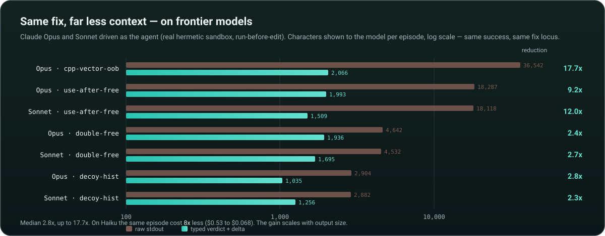

# Frontier context-efficiency result — Claude Opus + Sonnet

**2026-08-23.** Run locally via the Claude Code CLI backend (`claude-cli:`), driving each model
turn-by-turn as the agent under test, against the **real hermetic sandbox** (WSL, unprivileged user
namespaces — not `--no-sandbox`), with the `--run-before-edit` control.

## Setup
- **Models:** Claude Sonnet, Claude Opus.
- **Tasks:** 4 C/C++ memory-safety bugs — `c-decoy-hist`, `c-double-free`, `c-use-after-free`, `cpp-vector-oob`.
- **Conditions:** `raw` (raw stdout) vs `structured_delta` (typed Verdict + Delta + run-memory `loop:` signals).
- **`--run-before-edit`:** the agent must run the buggy program once before editing, so the `raw` arm
  actually receives the crash output in context — otherwise a frontier model fixes from source and
  never looks at it (the bypass regime).
- **Metric:** `shown_chars` — characters of tool-result the agent was shown, summed over the episode.
  Same fix locus and same success were verified for each pair.

## Result — same fix, 2–18× less context

| model  | task             | raw shown | structured_delta shown | reduction | fix line | success (raw/typed) |
|--------|------------------|-----------|------------------------|-----------|----------|---------------------|
| Sonnet | decoy-hist       |  2,882    |  1,256                 | 2.3×      | 6        | ✓ / ✓ |
| Sonnet | double-free      |  4,532    |  1,695                 | 2.7×      | 37       | ✓ / ✓ |
| Sonnet | use-after-free   | 18,118    |  1,509                 | **12.0×** | 29       | ✓ / ✓ |
| Sonnet | cpp-vector-oob   | 36,302    |  — (agent flake)       | —         | 14       | ✓ / flake |
| Opus   | decoy-hist       |  2,904    |  1,035                 | 2.8×      | 6        | ✓ / ✓ |
| Opus   | double-free      |  4,642    |  1,936                 | 2.4×      | —        | ✓ / ✓ |
| Opus   | use-after-free   | 18,287    |  1,993                 | **9.2×**  | 29       | ✓ / ✓ |
| Opus   | cpp-vector-oob   | 36,542    |  2,066                 | **17.7×** | 14       | ✓ / ✓ |

**7 clean pairs: same success, same fix locus, median 2.8× less context (range 2.3–17.7×).** The
reduction scales with output size — on the 18 KB use-after-free and 36 KB vector-oob crashes it is 9–18×.

Cost of the run: Sonnet **$3.38**, Opus **$12.60** (16 episodes).

## Honest interpretation
- This is a **context-efficiency** result, not a capability one. Both frontier models fix these bugs
  from source (same success on the 7 clean pairs, comparable turns; the one incomplete cell was an
  infra flake, below). On small, readable bugs a strong model fixes
  from source and does not loop — so the feedback *content* (delta, anti-loop) is not load-bearing here.
  What the typed *presentation* still buys is **2–18× less context for the same outcome** — real
  token / cost / latency savings that compound across long agent sessions.
- The stronger claim — that run-memory / anti-loop **helps** a frontier model escape a red-herring loop
  — is **not** shown by this experiment: these tasks are too tractable for Opus/Sonnet to loop (they
  even read through the `c-decoy-hist` trap and fixed the real site in one edit). That needs
  source-insufficient tasks where even a frontier model must iterate — the open frontier.
- The one blank cell (Sonnet × cpp-vector-oob × structured_delta) was an **agent flake**, not a
  pipeline/sbx bug: the CLI model called `list_files` twice, produced prose, never read/edited/ran, and
  exhausted its nudges. Opus covers that task at 17.7×.

## The anti-loop boundary — capable models don't loop on synthetic tasks

The run-memory `loop:` signal only helps if the agent actually loops (repeats a fix that leaves the
verdict unchanged). To test whether it helps a capable model, we built three tasks *engineered* to
induce a loop — the "obvious" fix provably fails, so a naive agent should edit, re-run, see the same
crash, and circle:

- **`c-decoy-hist`** — the crash surfaces in `tally()`, but the fix is an off-by-one in `capacity()`
  two functions away.
- **`c-grow-oob`** — a fixed buffer overflown by a PRNG-generated stream whose total size is not
  knowable from the source; a bigger constant still overflows (only a dynamic buffer works).
- **`c-namebuf`** — runtime-length names copied into a fixed struct field; bumping the constant to 32
  still overflows (verified — only ≥ 48 works).

Across these three tasks and four models (Haiku, Sonnet, Opus), **not one produced a loop.** Sonnet
and Opus read through every trap and fixed the real site in a single edit; Haiku, when it engaged,
jumped straight to a large-enough buffer, and otherwise simply failed to act (a weak agent, not a
loop). The `loop:` signal never fired — there was nothing to break.

This cleanly refutes the hypothesis that run-memory / anti-loop helps a *capable* model on tractable
tasks: such models fix from source and do not circle. The signal's value therefore lives where a
model genuinely cannot fix from source — real, source-insufficient bugs (large multi-file codebases,
ARVO / SWE-bench), where even a frontier model must iterate over many runs. That is the open frontier
(see the repo README / REPORT Future work), not something a self-contained synthetic task can show.

Loop-probe tasks: `bench/tasks/{c-decoy-hist,c-grow-oob,c-namebuf}`.

Raw data: [`bench/results/frontier-opus-sonnet.jsonl`](../bench/results/frontier-opus-sonnet.jsonl).
